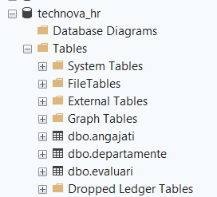
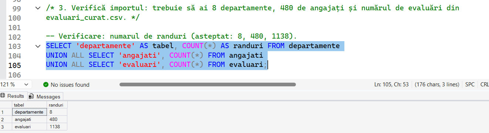
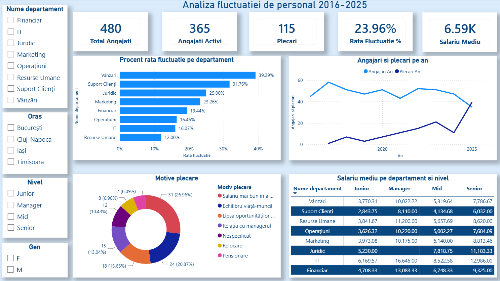
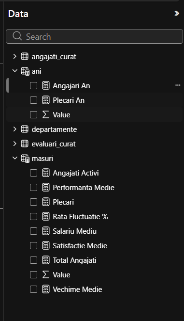

# Analiza fluctuatiei de personal - TechNova HR (2016-2025)

## 1. Scopul proiectului

Proiectul analizeaza fluctuatia de personal (angajati care pleaca din companie) la compania **TechNova**, pe perioada 2016-2025. Pornind de la trei tabele brute (angajati, departamente, evaluari), datele sunt curatate in Excel si Python, interogate in SQL Server si prezentate intr-un dashboard Power BI. Scopul final este sa raspundem la intrebari de business despre cine pleaca, de ce pleaca si ce poate face departamentul de HR pentru a reduce fluctuatia.

## 2. Structura repository-ului

```
01_Excel_curatare.xlsx        Etapa 1 - curatare date in Excel (cu jurnal_curatare si pivot)
02_Python_analiza.ipynb       Etapa 2 - curatare evaluari si analiza exploratorie in Python
03_SQL_interogari.sql         Etapa 3 - creare baza de date, import si interogari SQL
04_PowerBI_dashboard.pbix     Etapa 4 - dashboard Power BI
date/                         Fisierele CSV (brute si curatate)
capturi/PowerBi/              Capturi de ecran din dashboard si lista de masuri
capturi/SQL/                  Capturi de ecran cu rezultatele interogarilor SQL
README.md                     Acest fisier (Etapa 5 - concluzii si documentatie)
```

## 3. Descrierea datelor

Datele sunt in folderul [date/](date/).

| Fisier               | Randuri | Descriere                                                |
| -------------------- | ------- | -------------------------------------------------------- |
| `angajati.csv`       | 492     | Date brute despre angajati (16 coloane)                  |
| `angajati_curat.csv` | 480     | Angajati curatati, plus 5 coloane calculate (21 coloane) |
| `departamente.csv`   | 8       | Departamentele: id, nume, oras sediu, buget anual (lei)  |
| `evaluari.csv`       | 1.149   | Evaluari brute, pentru anii 2023-2025                    |
| `evaluari_curat.csv` | 1.138   | Evaluari curatate in Python                              |

**angajati_curat.csv** contine: `id_angajat`, `nume`, `prenume`, `gen`, `data_nasterii`, `data_angajarii`, `id_departament`, `functie`, `nivel` (Junior / Mid / Senior / Manager), `oras`, `tip_contract`, `salariu_brut_lunar`, `status` (Activ / Plecat), `data_plecarii`, `motiv_plecare`, `email` si coloanele calculate `nume_departament`, `varsta`, `vechime_ani`, `grupa_vechime`, `plecat` (1 = a plecat, 0 = activ).

**evaluari_curat.csv** contine: `id_evaluare`, `id_angajat`, `an_evaluare`, `scor_performanta` (1-5), `satisfactie_angajat` (1-10), `ore_suplimentare_lunare`, `ore_training_anual`, `zile_concediu_medical`, `procent_bonus`.

Relatii: `angajati.id_departament` -> `departamente`, `evaluari.id_angajat` -> `angajati`.

## 4. Probleme gasite si cum au fost rezolvate

**Excel** (detaliat in foaia `jurnal_curatare` din [01_Excel_curatare.xlsx](01_Excel_curatare.xlsx)):

| Problema                                                            | Cazuri    | Rezolvare                                                                                                |
| ------------------------------------------------------------------- | --------- | -------------------------------------------------------------------------------------------------------- |
| Randuri duplicate in angajati                                       | 12        | Data -> Remove Duplicates                                                                                |
| Spatii in plus la nume/prenume, litere mari/mici gresite            | 2 coloane | `TRIM`, `PROPER`                                                                                         |
| Valori nestandardizate la gen (ex: "Masculin"), oras, nivel, status | 4 coloane | `TRIM`, `UPPER`/`LOWER`, `LEFT`, `IF`, `PROPER`                                                          |
| Formate diferite de data                                            | 3 coloane | `DATE` cu `LEFT`/`MID`/`RIGHT`                                                                           |
| `id_departament` lipsa                                              | 8         | `XLOOKUP` dupa functie                                                                                   |
| Salariu negativ (1) sau prea mare (2)                               | 3         | Valoare absoluta, respectiv impartire la 10/100 daca se potriveste cu media departamentului si nivelului |
| Salarii egale cu 0                                                  | 19        | Tratate ca lipsa si completate cu mediana pe departament si nivel                                        |
| Angajati plecati fara motiv                                         | 12        | Completati cu "Nespecificat"                                                                             |
| E-mail lipsa                                                        | 10        | Identificate cu `COUNTBLANK`, lasate necompletate                                                        |

**Python** (tabelul `evaluari`, in [02_Python_analiza.ipynb](02_Python_analiza.ipynb)):

| Problema                                                                   | Cazuri    | Rezolvare                                                         |
| -------------------------------------------------------------------------- | --------- | ----------------------------------------------------------------- |
| Randuri duplicate                                                          | 8         | `drop_duplicates()`                                               |
| Valori lipsa: scor / satisfactie                                           | 30 / 25   | Completate cu mediana coloanei (nu influentata de valori extreme) |
| Scor in afara 1-5 / satisfactie in afara 1-10 / ore suplimentare peste 100 | 4 / 3 / 3 | Transformate in NaN, apoi completate cu mediana                   |
| Evaluari cu `id_angajat` inexistent (cheie straina)                        | 3         | Eliminate                                                         |

Rezultat: `evaluari` a scazut de la 1.149 la 1.138 randuri, fara valori lipsa si fara duplicate.

## 5. Lista KPI-urilor

KPI-urile sunt definite ca masuri in Power BI (vezi [capturipowerbi_masuri.png](capturi/PowerBi/capturipowerbi_masuri.png)):

| KPI                      | Valoare                                        |
| ------------------------ | ---------------------------------------------- |
| Total Angajati           | 480                                            |
| Angajati Activi          | 365                                            |
| Plecari                  | 115                                            |
| Rata Fluctuatie %        | 23,96%                                         |
| Salariu Mediu            | 6.588 lei                                      |
| Performanta Medie        | 3,55 (din 5, pe `evaluari_curat`)              |
| Satisfactie Medie        | 6,50 (din 10, pe `evaluari_curat`)             |
| Vechime Medie            | 4,5 ani                                        |
| Angajari An / Plecari An | masuri pe an, folosite in graficul de evolutie |

## 6. Instrumente folosite

| Instrument                  | Versiune                                            | Utilizare                                |
| --------------------------- | --------------------------------------------------- | ---------------------------------------- |
| Microsoft Excel             | 2021 / Microsoft 365 (necesita `XLOOKUP`, `FILTER`) | Curatare date, tabele pivot              |
| Python                      | 3.14.7                                              | Curatare si analiza exploratorie         |
| pandas                      | 3.0.6                                               | Prelucrare date                          |
| NumPy                       | 2.5.3                                               | Calcule numerice                         |
| Matplotlib                  | 3.11.2                                              | Grafice                                  |
| Jupyter (ipykernel)         | 7.4.0                                               | Rulare notebook                          |
| Microsoft SQL Server + SSMS | T-SQL (`BULK INSERT`, `TOP`)                        | Baza de date `technova_hr` si interogari |
| Power BI Desktop            | -                                                   | Dashboard                                |

## 7. Instructiuni de rulare

Fisierele se deschid sau se ruleaza in aceasta ordine:

1. **`01_Excel_curatare.xlsx`** - se deschide in Excel. Foaia `angajati`, `departamente` si `evaluari` contin datele brute, `angajati_curat` rezultatul curatarii, `pivot` tabelele pivot, iar `jurnal_curatare` descrie pasii. Foaia `angajati_curat` se exporta ca `date/angajati_curat.csv`.
2. **`02_Python_analiza.ipynb`** - se ruleaza in Jupyter / VS Code, de sus in jos, din radacina repository-ului (notebook-ul citeste `date/...`). Citeste `angajati_curat.csv`, `departamente.csv`, `evaluari.csv` si **genereaza** `date/evaluari_curat.csv`. Dependente: `pip install pandas numpy matplotlib`.
3. **`03_SQL_interogari.sql`** - se copiaza `departamente.csv`, `angajati_curat.csv` si `evaluari_curat.csv` in `C:\temp\` (sau se modifica caile din `BULK INSERT`), apoi se ruleaza scriptul in SSMS, in ordine: creare baza de date si tabele, import (departamente, angajati, evaluari - din cauza cheilor straine), verificare (8 / 480 / 1.138 randuri), interogarile B.1-B.12.
4. **`04_PowerBI_dashboard.pbix`** - se deschide in Power BI Desktop. Foloseste `angajati_curat`, `departamente` si `evaluari_curat`; daca se cere, se actualizeaza sursele (Transform data -> Data source settings) catre folderul `date/`.

## 8. Rezultate SQL (capturi de ecran)

Baza de date `technova_hr` cu cele 3 tabele: [DB.png](capturi/SQL/DB.png)



Crearea tabelelor si importul: [A.1](capturi/SQL/A.1.png), [A.1.1](capturi/SQL/A.1.1..png), [A.2](capturi/SQL/A.2.png), [A.2.1](capturi/SQL/A.2.1..png). Verificarea importului (8 departamente, 480 angajati, 1.138 evaluari): [A.3](capturi/SQL/A.3.png).



Interogarile obligatorii (rezultate):

| Nr.  | Interogare                                                                     | Captura                                                            |
| ---- | ------------------------------------------------------------------------------ | ------------------------------------------------------------------ |
| B.1  | Total angajati, activi si plecati                                              | [B.1](capturi/SQL/B.1.png)                                         |
| B.2  | Angajati pe departament (JOIN)                                                 | [B.2](capturi/SQL/B.2.png)                                         |
| B.3  | Salariu mediu / minim / maxim pe nivel                                         | [B.3](capturi/SQL/B.3.png)                                         |
| B.4  | Rata de plecare pe departament                                                 | [B.4](capturi/SQL/B.4.png)                                         |
| B.5  | Departamente cu rata de plecare peste 20% (HAVING)                             | [B.5](capturi/SQL/B.5.png)                                         |
| B.6  | Salariu mediu pe gen in fiecare departament                                    | [B.6](capturi/SQL/B.6.png)                                         |
| B.7  | Top 10 angajati activi dupa salariu                                            | [B.7](capturi/SQL/B.7.png)                                         |
| B.8  | Motive de plecare si procent din total plecati                                 | [B.8](capturi/SQL/B.8.png)                                         |
| B.9  | Angajati cu salariu peste media departamentului (subinterogare)                | [B.9](capturi/SQL/B.9.png)                                         |
| B.10 | Angajati fara nicio evaluare (44) si statusul lor                              | [B.10.1](capturi/SQL/B.10.1.png), [B.10.2](capturi/SQL/B.10.2.png) |
| B.11 | Evaluari 2025 pe categorii de satisfactie: Scazuta 45, Medie 239, Ridicata 120 | [B.11](capturi/SQL/B.11.png)                                       |
| B.12 | Scor, bonus si ore suplimentare medii pe departament, 2025 (JOIN pe 3 tabele)  | [B.12](capturi/SQL/B.12.png)                                       |

## 9. Dashboard Power BI

Dashboard-ul "Analiza fluctuatiei de personal 2016-2025" contine cardurile KPI, rata de fluctuatie pe departament, evolutia angajarilor si plecarilor pe ani, motivele de plecare, tabelul salariului mediu pe departament si nivel si filtre pe departament, oras, nivel si gen.




## 10. Concluzii si recomandari (raspunsuri la intrebarile de business)

Cifrele provin din [02_Python_analiza.ipynb](02_Python_analiza.ipynb), din foaia `pivot` a fisierului Excel si din interogarile SQL; cele pe gen au fost calculate pe `angajati_curat.csv`.

### 1. Care sunt departamentele si nivelurile cu cea mai mare rata de plecare?

Rata generala de plecare este de **23,96%** (115 plecati din 480 de angajati).

- Departamente: **Vanzari 39,29%** (33 din 84) si **Suport Clienti 31,76%** (27 din 85), urmate de Juridic 25,00%, Marketing 23,26%, Financiar 19,44%, Operatiuni 16,46%, IT 16,07% si Resurse Umane 12,00%.
- Niveluri: **Junior 29,94%** (47 din 157), Senior 22,81%, Mid 20,69% si Manager 17,14%.
- Vanzari si Suport Clienti au impreuna 60 din cele 115 plecari (52%). Juridic are doar 16 angajati, deci rata de 25% (4 plecari) este mai putin stabila statistic.

### 2. Prin ce se deosebesc angajatii care au plecat de cei care au ramas?

Medii pe angajat, activi vs plecati:

| Indicator                 | Activi    | Plecati   |
| ------------------------- | --------- | --------- |
| Salariu brut lunar        | 6.777 lei | 5.991 lei |
| Vechime                   | 5,16 ani  | 2,57 ani  |
| Ore suplimentare / luna   | 7,22      | 10,46     |
| Satisfactie (1-10)        | 6,57      | 6,00      |
| Scor de performanta (1-5) | 3,56      | 3,61      |

Cei plecati au salarii mai mici, jumatate din vechime, mai multe ore suplimentare si satisfactie mai scazuta, dar performanta este practic aceeasi, deci nu pleaca cei slabi. Corelatii cu plecarea: vechime **-0,392**, ore suplimentare **+0,212**, satisfactie **-0,125**, salariu **-0,112**. Riscul scade puternic cu vechimea: 52% dintre cei cu vechime sub 1 an au plecat (25 din 48), 40% la 1-3 ani si doar 6,8% peste 5 ani. Corelatiile arata asociere, nu cauzalitate.

### 3. De ce spun angajatii ca pleaca (motivele principale)?

Din cei 115 plecati: **salariu mai bun in alta parte 31 (27,0%)**, **echilibru viata-munca 24 (20,9%)**, **lipsa oportunitatilor de promovare 18 (15,7%)**, relatia cu managerul 15, nespecificat 12, relocare 8, pensionare 7. Primele trei motive insumeaza 73 de plecari (63,5%), adica aproape doua treimi au cauze pe care compania le poate influenta. In Suport Clienti, cel mai frecvent motiv este salariul (9 plecari).

### 4. Exista diferente salariale importante intre departamente, niveluri sau genuri?

Da, mai ales intre departamente si niveluri.

- **Departamente:** salariul mediu merge de la **4.562 lei** (Suport Clienti) la **9.278 lei** (IT), adica de aproximativ 2 ori mai mult. Vanzari (5.674 lei) si Operatiuni (5.748 lei) sunt tot sub media companiei de 6.588 lei.
- **Niveluri:** Junior 4.452 lei, Mid 5.953 lei, Senior 8.846 lei, Manager 11.974 lei (de ~2,7 ori un Junior); cel mai mare salt este Senior -> Manager (+3.128 lei).
- **Genuri:** barbatii castiga in medie 6.848 lei, femeile 6.361 lei (diferenta de 487 lei, ~7,7%). Diferenta apare la Junior (4.700 vs 4.241 lei) si Senior (9.441 vs 8.162 lei); la Mid este neglijabila, iar la Manager femeile au media mai mare (12.143 vs 11.721 lei). Rata de plecare este similara: 22,7% femei, 25,5% barbati.

### 5. Trei recomandari concrete pentru HR

1. **Revizuirea salariilor in Suport Clienti, Vanzari si la nivelul Junior.** Suport Clienti are cel mai mic salariu mediu (4.562 lei) si a doua cea mai mare rata de plecare (31,76%), Juniorii castiga 4.452 lei si pleaca in proportie de 29,94%, iar "salariu mai bun in alta parte" este motivul numarul 1 (31 de plecari, 27%). O aliniere la piata in aceste grupuri vizeaza cele 60 de plecari din Vanzari si Suport Clienti.
2. **Reducerea suprasolicitarii si politici pentru echilibrul viata-munca.** Angajatii plecati lucrau in medie 10,46 ore suplimentare pe luna fata de 7,22 la cei activi (corelatie +0,212 cu plecarea), iar echilibrul viata-munca este motivul a 24 de plecari (20,9%). Se recomanda plafonarea orelor suplimentare si monitorizarea lor lunara, cu prioritate in Vanzari (7 plecari pe acest motiv).
3. **Program de onboarding si de promovare pentru primii 3 ani.** 52% dintre angajatii cu vechime sub 1 an si 40% dintre cei cu 1-3 ani au plecat, fata de 6,8% peste 5 ani (corelatie vechime-plecare -0,392). Cum 18 plecari (15,7%) invoca lipsa promovarii si salariul creste cu 3.128 lei la trecerea Senior -> Manager, se recomanda trasee de cariera clare si evaluari de retentie dupa 6 si 12 luni.

### Context: evolutia in timp

Angajarile au fost stabile (43-58 pe an in 2016-2024), dar plecarile au crescut de la 0 in 2016 la 21 in 2023, 11 in 2024 si **39 in 2025**, anul in care depasesc angajarile (35). 97 din cele 115 plecari (84%) au avut loc in 2021-2025, deci problema se agraveaza si reducerea fluctuatiei este urgenta.
